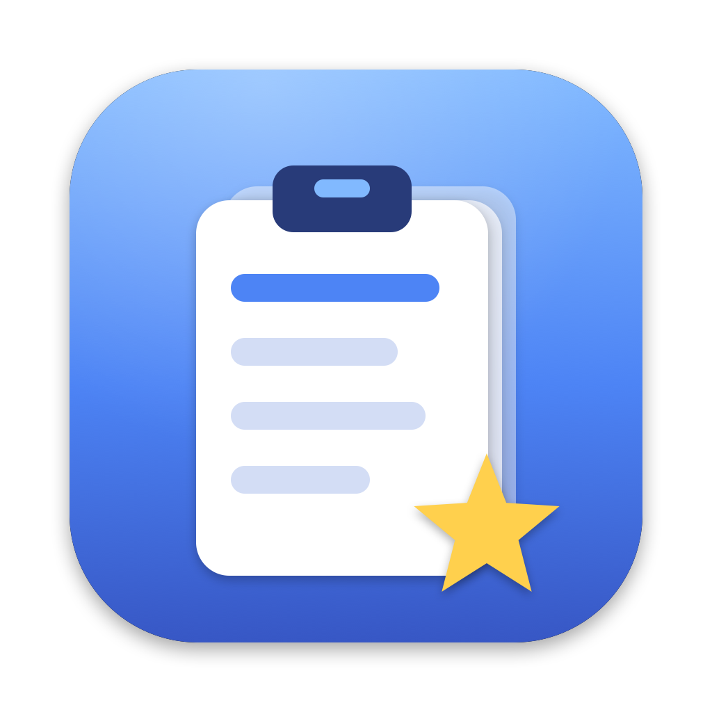
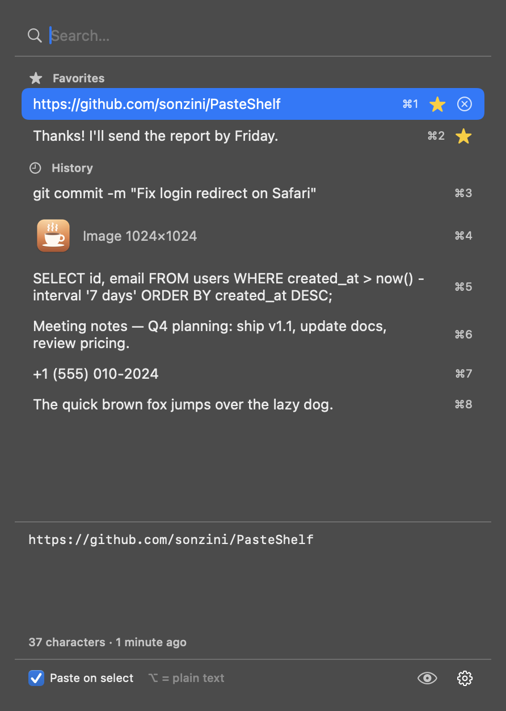

<p align="center">
  
</p>

<h1 align="center">PasteShelf</h1>

<p align="center">
  <b>El historial del portapapeles en la barra de menú de tu Mac.</b><br>
  Todo lo que copiás, a un clic. Gratis y de código abierto, inspirado en <i>Clipboard Indicator</i> de GNOME.
</p>

<p align="center">
  <a href="README.md">Read in English</a>
</p>

<p align="center">
  
</p>

## Funciones

- **Abrilo desde cualquier lado:** clic en el ícono de la barra de menú o <kbd>⌘</kbd> <kbd>⇧</kbd> <kbd>V</kbd>.
- **Elegí y se pega:** clic en un ítem (o <kbd>↑</kbd> <kbd>↓</kbd> + <kbd>Enter</kbd>) y se pega en la app donde estabas.
- **Pegado rápido:** <kbd>⌘1</kbd>…<kbd>⌘9</kbd> pega los primeros nueve ítems.
- **Respeta el formato:** negritas y links se pegan como los copiaste. Con <kbd>⌥ Opción</kbd> se pega **sin formato**.
- **También imágenes:** capturas e imágenes copiadas, con miniatura.
- **Favoritos:** con la estrella quedan fijos arriba para siempre.
- **Buscador** y **vista previa** del texto completo o la imagen.
- **Cuida tus contraseñas:** lo que copian 1Password, Bitwarden, el Llavero y otras apps que marcan datos como sensibles nunca se guarda.
- Guarda los últimos 100 ítems, **solo en tu Mac**. Inglés y español.

## Instalación

1. Bajá `PasteShelf-x.y.z.zip` desde la [última versión](https://github.com/sonzini/PasteShelf/releases/latest) y descomprimilo.
2. Arrastrá **PasteShelf.app** a **Aplicaciones** y abrilo.
3. La primera vez, macOS dice que no puede verificar al desarrollador. Andá a
   **Ajustes del Sistema → Privacidad y seguridad** y tocá **Abrir de todos modos**
   (o en la Terminal: `xattr -dr com.apple.quarantine /Applications/PasteShelf.app`).
4. La primera vez que elijas un ítem, macOS pide permiso de **Accesibilidad**: activá PasteShelf en
   **Ajustes del Sistema → Privacidad y seguridad → Accesibilidad**. Se usa solo para apretar <kbd>⌘V</kbd> por vos.
   Sin ese permiso igual copia el ítem y lo pegás vos.
5. Opcional: ⚙︎ → **Abrir al iniciar sesión**.

## Tus datos

El historial se guarda en `~/Library/Application Support/PasteShelf/`. Nunca se envía a ningún lado. Ver [PRIVACY.md](PRIVACY.md).

## Compilar

Necesitás macOS 14+ y Xcode 16 o más nuevo.

```bash
git clone https://github.com/sonzini/PasteShelf.git
cd PasteShelf
./scripts/build.sh --install
```

## Licencia

[MIT](LICENSE): libre para usar, modificar y compartir, incluso con fines comerciales.
