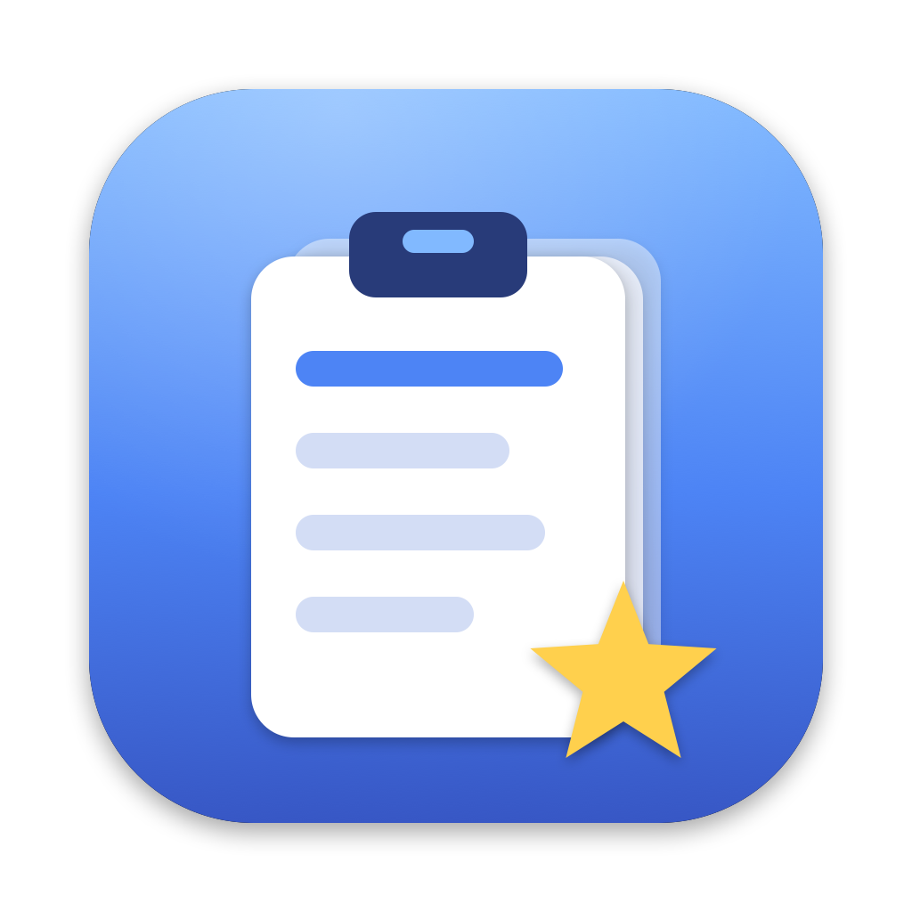
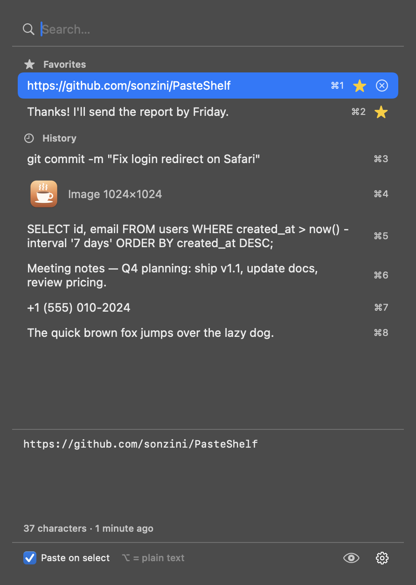

<p align="center">
  
</p>

<h1 align="center">PasteShelf</h1>

<p align="center">
  <b>Clipboard history in your Mac's menu bar.</b><br>
  Everything you copy, one click away. Free and open source, inspired by GNOME's <i>Clipboard Indicator</i>.
</p>

<p align="center">
  <a href="https://github.com/sonzini/PasteShelf/releases/latest"></a>
  <a href="https://github.com/sonzini/PasteShelf/actions/workflows/build.yml"></a>
  
  <a href="LICENSE"></a>
</p>

<p align="center">
  <a href="README.es.md">Leer en español</a>
</p>

<p align="center">
  
</p>

## Features

- **Open from anywhere:** click the clipboard icon in the menu bar or press <kbd>⌘</kbd> <kbd>⇧</kbd> <kbd>V</kbd>.
- **Pick and paste:** click an item (or use <kbd>↑</kbd> <kbd>↓</kbd> + <kbd>Return</kbd>) and it's pasted straight into the app you were using.
- **Quick paste:** <kbd>⌘1</kbd>…<kbd>⌘9</kbd> pastes the first nine items instantly.
- **Keeps formatting:** bold text, links and rich text paste exactly as copied. Hold <kbd>⌥ Option</kbd> to paste **plain text** instead.
- **Images too:** screenshots and copied images are saved with thumbnails.
- **Favorites:** star any item to pin it at the top forever.
- **Search** as you type, plus a **preview** of the full text or image.
- **Respects passwords:** anything copied from 1Password, Bitwarden, Keychain and other apps that mark data as
  [concealed](http://nspasteboard.org) is never saved.
- Keeps your last 100 items, **stored only on your Mac**. English and Spanish. No Dock icon, no tracking.

## Install

1. Download `PasteShelf-x.y.z.zip` from the [latest release](https://github.com/sonzini/PasteShelf/releases/latest) and unzip it.
2. Drag **PasteShelf.app** to your **Applications** folder and open it.
3. The first time, macOS will say it can't verify the developer (the app isn't notarized by Apple yet).
   Go to **System Settings → Privacy & Security**, scroll down and click **Open Anyway**.
   <details><summary>Or from Terminal</summary>

   ```bash
   xattr -dr com.apple.quarantine /Applications/PasteShelf.app
   ```
   </details>
4. The first time you pick an item, macOS asks for **Accessibility** permission. Turn on PasteShelf in
   **System Settings → Privacy & Security → Accessibility**. This is only used to press <kbd>⌘V</kbd> for you.
   Without it, PasteShelf still copies the item and you can paste it yourself. You can also turn off *Paste on select*.
5. Optional: ⚙︎ → **Launch at Login**.

## Usage

| Action | What it does |
| --- | --- |
| Menu bar icon / <kbd>⌘⇧V</kbd> | Open or close the panel |
| Type | Search |
| <kbd>↑</kbd> <kbd>↓</kbd> | Move the selection |
| <kbd>Return</kbd> or click | Paste the selected item |
| <kbd>⌘1</kbd>…<kbd>⌘9</kbd> | Paste item 1–9 |
| Hold <kbd>⌥</kbd> while choosing | Paste as plain text |
| ☆ / ⓧ | Favorite / delete an item |
| 👁 | Show or hide the preview |
| <kbd>Esc</kbd> | Close |

## Permissions, explained

| Permission | Why |
| --- | --- |
| **Accessibility** | To simulate <kbd>⌘V</kbd> in the app you were using (auto-paste). Optional. |
| **Clipboard** | Reading the clipboard is the whole point of the app. PasteShelf only looks at its contents when they change (it checks the pasteboard's change counter a couple of times per second, which doesn't read any data). |

## Your data

History is saved in `~/Library/Application Support/PasteShelf/` (`history.json` plus an `images/` folder).
Nothing is ever sent anywhere. Delete that folder, or use ⚙︎ → *Clear History*, to wipe it. Favorites survive *Clear History*.
See [PRIVACY.md](PRIVACY.md).

## App Store?

Not yet. Mac App Store apps must run in the App Sandbox, and the sandbox doesn't allow the Accessibility API that auto-paste needs.
An App Store edition would have to drop auto-paste (pick → copy → you press <kbd>⌘V</kbd>). This GitHub edition keeps every feature.

## Build from source

Requirements: macOS 14+ with Xcode 16 or newer.

```bash
git clone https://github.com/sonzini/PasteShelf.git
cd PasteShelf
./scripts/build.sh --install     # builds Release, copies to /Applications and opens it
```

Or open `PasteShelf.xcodeproj` in Xcode and press Run. Run the tests with:

```bash
xcodebuild test -project PasteShelf.xcodeproj -scheme PasteShelf -destination 'platform=macOS'
```

Tests use a private pasteboard and a temporary folder, so they never touch your real clipboard or history.

The Xcode project is generated from [`project.yml`](project.yml) with [XcodeGen](https://github.com/yonaskolb/XcodeGen).
If you change it, run `xcodegen generate`.

### Project layout

```
PasteShelf/
├── AppDelegate.swift      menu bar item, panel, keyboard, auto-paste
├── ContentView.swift      the panel UI (SwiftUI)
├── ClipboardStore.swift   history model: watching, saving, favorites, images
├── HotKey.swift           global keyboard shortcut (Carbon)
├── Localization.swift     L("…") helper
└── Resources/             app icon, en/es strings
PasteShelfTests/           unit tests
scripts/                   build and icon generators
```

## Contributing

Issues and pull requests are welcome. Translations are easy to add: copy `PasteShelf/Resources/es.lproj`
to your language and translate the right-hand side.

## License

[MIT](LICENSE). Free to use, modify and share, including commercially.
